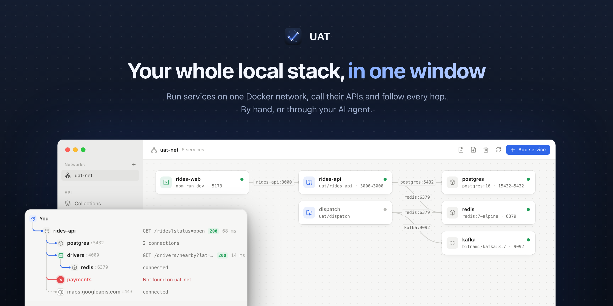
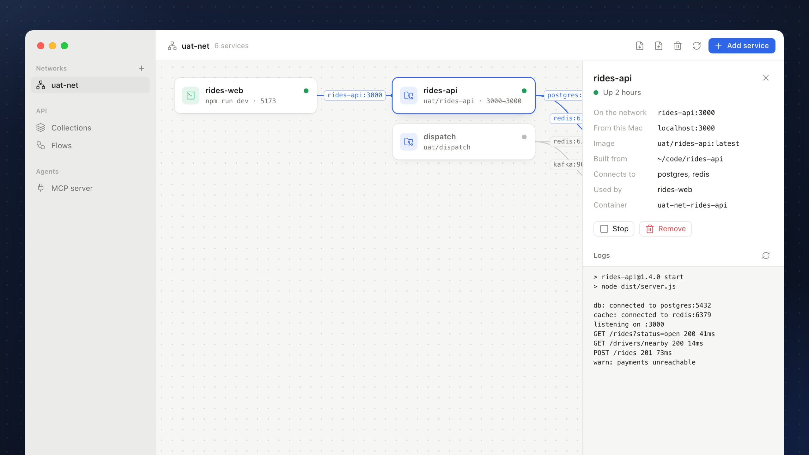
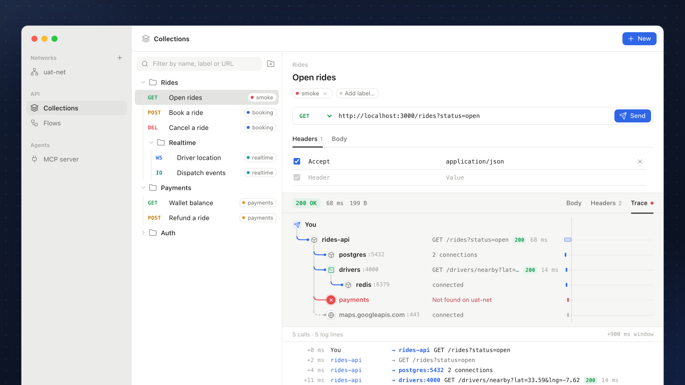
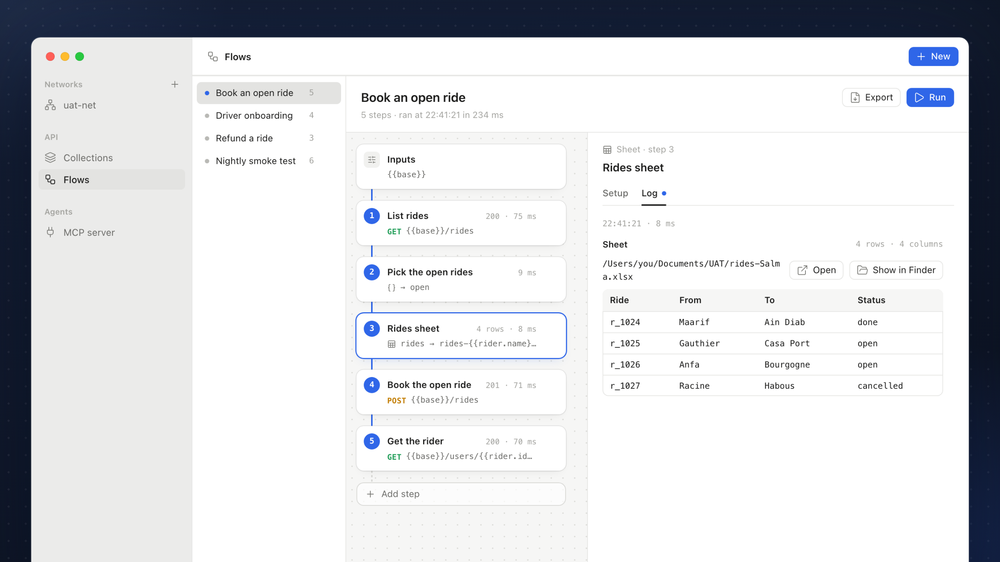
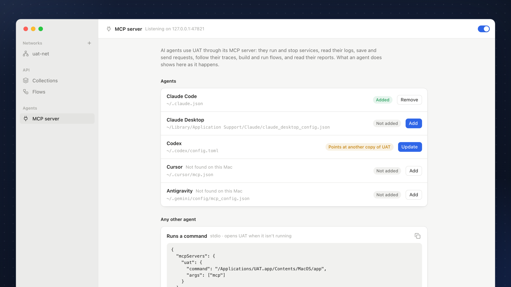
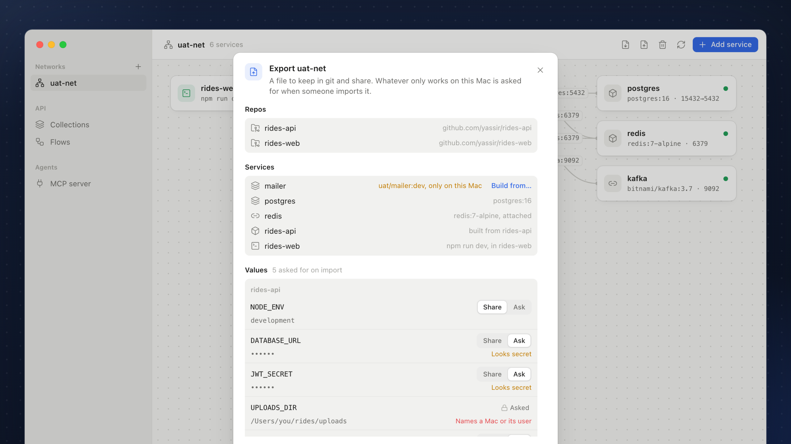

<p align="center">
  
</p>

<p align="center">
  <b>Run your local stack, call its APIs, and see where every call went.</b><br>
  A desktop app for the services you work on, built with Tauri, React and Rust.
</p>

<p align="center">
  
  
  
  
</p>

<p align="center">
  <a href="#one-network-for-every-service">Networks</a> ·
  <a href="#call-an-api-see-every-hop">Collections and traces</a> ·
  <a href="#chain-calls-into-flows">Flows</a> ·
  <a href="#hand-it-to-your-ai-agent">AI agents</a> ·
  <a href="#share-the-stack-through-git">Sharing</a> ·
  <a href="#run">Run it</a>
</p>

### One network for every service

Put a stack on one Docker network: a repo with a Dockerfile, an image, a command run on your Mac (`npm run dev` in a folder), or a container someone started elsewhere. Each service reaches the others by name (`postgres:5432`), the canvas draws who talks to whom, and the inspector shows a service's address, what it connects to and its logs.



### Call an API, see every hop

Keep HTTP requests, WebSocket and Socket.IO connections in groups that nest, each with a name and labels. Send one to a service and its Trace tab follows the call: every service it reached and what each called next, a red ✕ where a call went nowhere, and every service's log lines from that moment, in order.



### Chain calls into flows

A flow runs steps in order, each using what the earlier ones kept: call an API and keep parts of its answer, reshape them with a little JavaScript, post them on to another API, write rows to an .xlsx or .csv sheet. Each step keeps its own log, and the one that failed is the red one.



### Hand it to your AI agent

UAT's MCP server gives Claude Code, Claude Desktop, Codex, Cursor, Antigravity or any MCP client 43 tools: add, run and stop services and read their logs, send requests and read their traces, build and run flows and read their reports. Adding UAT to an agent is one click, and what the agent does shows in the window as it happens.



### Share the stack through git

Export writes a network to `<network>.uat.json`, with its services named by their git repos and nothing tied to your Mac. Import finds the clones by their remote, asks for the secrets and paths the file left out, and brings the same stack up on a teammate's Mac.



## Run

```bash
npm install
npm run tauri dev
```

Docker Desktop, OrbStack, Colima or Rancher Desktop must be running for the Networks section. The app finds the engine's socket on its own (`DOCKER_HOST`, then the usual socket paths), so it doesn't need the `docker` CLI on `PATH`.

`npm run dev` alone serves the UI in a browser with sample Docker data, for working on layout. Docker and file storage need the desktop app.

```bash
npm run tauri build      # release bundle in src-tauri/target/release/bundle
npm test                 # the flow engine, the flow demo, reports and MCP tools (vitest)
cd src-tauri && cargo test
```

`UAT_MCP_E2E=1 npx vitest run e2e` drives the MCP server end to end through the official SDK, the way an agent does. It starts a second UAT (the `cargo build` binary, with the UI from `npm run dev`) under a scratch HOME, so your workspace and flows aren't touched, then saves and sends requests, builds, runs and exports a flow, and checks the errors it gives. With `UAT_MCP_E2E_DOCKER=1` it also runs a command as a service on its own network, `uat-mcp-e2e`, and removes both after. Then it builds a network from a scratch git repo (a service built from it, `alpine:3.20`, and a command), exports it and checks nothing of the Mac is in the file, removes it, and imports it back: the clone is found by its remote, the left-out values and a taken port are asked for, and the answers end up in the containers. It leaves `alpine:3.20` alone and removes the rest. Quit your own UAT first: a UAT that starts removes every UAT trace sidecar and command proxy, including those of a copy already running.

With the demo running in the app (New → Flow demo or Trace demo), `UAT_DEMO_PORT=8480 npm test` also runs the flow demo against its real gateway; use the port the demo's group shows.

`cargo test -- --ignored --nocapture live_` runs against the local engine, on throwaway networks, and removes what it makes. It checks six things. A service built from a Dockerfile reaches `redis:7-alpine` by name. A container reaches a server on this Mac by name through the proxy. A command goes through its whole life in the app: start, logs, proxy, stop, remove. A request to a Node command is traced through a container it calls and on to a third, with the names that didn't resolve on either side (it uses the `caddy:2-alpine` and `oven/bun:1.3-slim` images). The trace demo sets itself up and traces its three requests: blue all the way, red at `payments`, and nothing for a health check. Removing a network takes the container built for it with its image and volume, and the command with its proxy, and leaves an attached container running.

## Removing a network

The bin in a network's toolbar, or Remove network… when you right-click it in the sidebar, removes it from Docker with what UAT runs on it. First it lists what will go:

- containers UAT made on it, which are deleted;
- commands run as its services, which are stopped and deleted from UAT (their folders are left alone);
- containers started elsewhere and attached, which are only disconnected and keep running;
- the images and volumes those containers used, as two choices, both on. An image or volume another container still uses stays, and the list says which container. Removing a volume deletes its data. UAT's own helper images (the proxy and the trace sidecar) stay, as other networks use them.

Then it stops watching the network for traces, removes it all, and says what went and what stayed. `uat-net` is UAT's default, so UAT makes it again, empty. The engine's own `bridge`, `host` and `none` can't be removed.

## Sharing a network

A network can go in a file to keep in git, so a team brings up the same stack from it. Export network… (the up arrow in a network's toolbar, or right-click it in the sidebar) writes `<network>.uat.json`. Import network… reads one: the down arrow beside it adds the file to that network, and the + beside Networks to a network named in the file.

The file says what runs, not where it ran. Services that come from a folder are named by the git repo it's in (`github.com/yassir/rides-api`, the same whichever URL anyone cloned it with) and the folder inside it, and the repos are listed by name with the URL to clone them, without any credentials. Nothing that only works on one Mac goes in:

- **Always left out:** anything naming the Mac or its user, like a path in the home folder (`/Users/…`, `~/…`, `C:\Users\…`), the user's name or the Mac's.
- **Left out unless you share it:** values that look secret (by their name, like `JWT_SECRET` or `DB_PASSWORD`, or by their value, like a URL with a password in it or a GitHub token), other paths (`./config/local.json`, `/etc/ssl/cert.pem`) and addresses on a local network (`192.168.1.20`, `mac.local`). Export lists every value with Share and Ask, so you can share a dev password or ask for anything else. A path you choose to ask for keeps its value as the suggestion; secrets and local addresses don't.
- **Said, not left out:** an image only built on this Mac, which others can't pull, and a folder that isn't in a git repo with a remote, which each person picks.

An image only built on this Mac shows in amber in the list of services, with **Build from…**: choose the folder with its Dockerfile (and the Dockerfile, when it isn't at the folder's top), and the file builds the service from that folder's repo like any other `build`, so others get it from the code. **Use image** goes back. Left as it is, the file marks it `"local": true` and import asks how to get it.

A command already carries its folder's repo (`run`), and a folder outside git is asked for on import, so commands need nothing more.

```json
{
  "uat": 1,
  "kind": "network",
  "name": "rides",
  "repos": {
    "rides-api": { "git": "github.com/yassir/rides-api", "clone": "git@github.com:yassir/rides-api.git" },
    "rides-web": { "git": "github.com/yassir/rides-web", "clone": "https://github.com/yassir/rides-web.git" }
  },
  "services": {
    "api": {
      "build": { "repo": "rides-api", "path": "services/api", "dockerfile": "Dockerfile.dev" },
      "ports": ["3000:3000"],
      "env": {
        "NODE_ENV": "development",
        "JWT_SECRET": { "ask": "Looks secret", "secret": true },
        "CONFIG": { "ask": "A path", "default": "./config/local.json" }
      },
      "dependsOn": ["db"]
    },
    "db": { "image": "postgres:16", "ports": ["5432"], "env": { "POSTGRES_PASSWORD": "rides" } },
    "web": { "run": { "repo": "rides-web", "command": "npm run dev" }, "ports": ["5173"], "dependsOn": ["api"] },
    "redis": { "attached": { "image": "redis:7-alpine", "container": "compose-redis-1" } },
    "mailer": { "image": "uat/mailer:dev", "local": true }
  }
}
```

A service has one of `build` (a Dockerfile in a repo), `image` (with `local` when it was only built on the exporter's Mac), `run` (a command in a repo, run on the Mac) or `attached` (a container started outside UAT). Any value can be `{ "ask": why }`, with a `default` and `secret`.

Importing asks only what the file and this Mac leave open:

- **Where each repo is.** UAT looks for clones in the usual code folders (`~/code`, `~/workspace`, `~/projects`, `~/Developer`, `~/src` and the like, four levels down) and matches them by their git remote, so a clone in a folder with another name is still found. Otherwise choose its folder, or clone it into one.
- **The values the file left out.** Secrets are typed into hidden fields.
- **A host port that's taken here**, with a free one suggested, or none to keep it on the network only.
- **For each attached container,** whether to run its image on the network, attach a container running here (one with the same name is picked), or leave it out.
- **For each image built on the exporter's Mac,** whether to use it, when this Mac has it too (picked when it does), build it from a folder with its Dockerfile, or leave it out. Nothing else is asked about a service that's left out.

Then it makes the network if needed and adds the services so each comes after those it depends on. Services the network already has are left as they are. Commands are added stopped, as a fresh clone usually needs `npm install` or the like first.

## Commands as services

A command runs on this Mac, not in a container, through your login shell's environment (so `nvm`, Homebrew and the like work). The app keeps its output for the log view and stops its whole process tree on Stop or when the app quits.

When it has ports, it joins its network through a small proxy container named after it (`uat/proxy:1`, socat on Alpine, built the first time). The proxy forwards each port to `host.docker.internal`, so containers reach it as `name:port` even when it listens on `127.0.0.1`. The command reaches containers at their published `localhost` ports; the inspector lists them under "Connects to".

Commands are saved in `processes.json` in the app data folder. Edits to the command, ports or environment apply on the next start.

## Call traces

The app finds the service a call reaches from its URL: a `localhost` port that a container publishes, or that a command lists as its port. Before the call goes out, it starts watching that service's network, and keeps watching it while the app runs.

Watching a network puts a sidecar beside each running container (`uat/sniff:1`, tcpdump on Alpine, built the first time). The sidecar shares the container's network namespace, runs with `NET_RAW` and `NET_ADMIN`, and sends packets back over `attach`, not to a log. From them the app keeps the names a container looked up, the connections it opened and whether they were accepted, and the request and status lines of plain HTTP. Sidecars are removed when the app quits, and any left over are removed when it starts.

Commands on this Mac run with `NODE_OPTIONS=--require …/trace-hook.cjs` (added to any `NODE_OPTIONS` they already have). The hook notes each connection and HTTP request (`http`, `https`, `fetch`) and how it ended, in a file the app reads. It adds no listeners, so an error the app doesn't handle still crashes it as before.

A trace is everything those saw from the moment the call was sent to 0.7 s after its answer (1.5 s after a socket message), followed from the service the call reached. What it can't show:

- the path and status of HTTPS or HTTP/2 calls between services (the connection shows, the request line doesn't);
- calls made by commands that aren't Node;
- what a service did on its own in the same window, which looks the same as what the call set off.

### Trace demo

New → Trace demo (or Try the trace demo, where a trace has nothing to show) sets up a small network, `uat-demo`, and adds a Trace demo group to Collections:

- `gateway`, published on a free port from 8480, calls `orders` and `users`;
- `orders` uses `redis`, and when a ride is booked it calls `payments`, which isn't on the network.

List rides traces blue all the way. Book a ride answers 502 and its trace ends in a red ✕ at `payments`. The services are one shell script behind socat (`uat/demo:1`, built the first time); each logs what it got and called, so the timeline has their lines too. Running it again starts the demo's containers if they were stopped and points the group at the gateway's port, keeping your edits. To get rid of it, open `uat-demo` in the Docker view and remove its services.

## Flows

A flow has inputs (`base = http://localhost:8480`) and steps, run top to bottom by Run:

- **API call.** A request like those in Collections (or copied from one with Add step → Call from Collections). `{{name}}` in the URL, headers and body fills in a value kept earlier: `{{base}}/rides/{{ride.id}}`. Text goes in as it is, lists and objects as JSON, so `"rides": {{open}}` sends a list. Keep from the answer names values by a path into it: `status`, `headers["x-request-id"]`, `body.rides`, `body.rides[0].id`, `body.rides[*].id`, `body.rides[-1]`. By default a call that doesn't answer 2xx stops the flow.
- **Transform.** JavaScript run with what earlier steps kept in scope by name (and in `vars`), and lodash as `_`; it returns the value to keep, and `log()` writes to the step's log. It works on copies, so earlier steps' logs stay as they were. The editor (Monaco) suggests as you type: the kept names, their fields as the last run saw them (`rides[0].` offers `id`, `from`, `to`, `status`), and every lodash function with its signature and docs, typed for what you pass it. ⌘I asks for suggestions (so does ⌃Space, unless macOS uses it to switch input sources), ⌘↵ runs the flow, and the sun and moon in its bar switch it between a light and a dark theme.
- **Sheet.** Rows from a list kept earlier, a column per header and path (every field of the rows when none are given), written to an .xlsx or .csv file, replaced on each run. A name alone goes in `~/Documents/UAT`.

The first step that fails stops the flow, and the rest are skipped. The step column shows it: blue into each step that ran, red into the one that failed with why under its name, dashed past it. Each step's Log has what it sent and got back, what it kept, a transform's log lines, or a sheet's first rows with Open and Show in Finder; API calls to a service in UAT also get a Trace tab. Inputs shows every value kept by the last run.

Export (beside Run) saves a report of the last run, as one HTML page (it opens in any browser and prints to PDF) or as Markdown (for a ticket or a pull request). It starts with the verdict, when the run started and how long it took, the inputs, and a summary of every step: its status, time and result. Then comes each step in full: what it sent and got back, what it kept, a transform's code and log, a sheet's file and rows, and, for calls to a service in UAT, the calls they led to with the services' logs. It's the flow as it ran, even if you've edited it since. Values that look secret are hidden: headers like Authorization and Cookie, inputs and kept values named like a token, key or password, and those values wherever else they turn up, in a URL or a body. Include secrets in the Export menu keeps them.

Flows run in the app's window, not in Rust; Rust keeps them in `flows.json` beside the workspace and writes the sheets. A run keeps going while another section is open.

### Flow demo

New → Flow demo (or Try the flow demo when there are no flows) sets up the trace demo's network and adds "Book an open ride": list the rides and keep them and the rider, pick the open ones, write all of them to `~/Documents/UAT/rides-Salma.xlsx`, then book the open one with a body built from them. Booking answers 502, as `payments` isn't on the network, so the flow stops there in red, its Trace tab shows the ✕ at `payments`, and Get the rider is skipped.

## MCP server

MCP server in the sidebar shows whether the server runs, adds UAT to the agents it finds on this Mac, and lists the latest calls and every tool.

- **Adding it to an agent.** Add writes UAT into the agent's own config, keeping what's there (a copy goes beside it as `.before-uat`): `~/.claude.json` through `claude mcp add` for Claude Code, `claude_desktop_config.json` for Claude Desktop, `~/.codex/config.toml` for Codex (with a 10-minute tool timeout, as flows and builds take a while), `~/.cursor/mcp.json` for Cursor, `~/.gemini/config/mcp_config.json` for Antigravity. Each row says what to do next, like restarting the agent. For any other agent, the page has the config to paste.
- **How agents reach it.** The agent runs this app with `mcp` (`…/UAT.app/Contents/MacOS/app mcp`), which speaks MCP over stdio. It answers the handshake itself and passes each tool call to the running UAT, opening it in the background first if it isn't running. Agents that connect to a URL can use `http://127.0.0.1:47821/mcp` (Streamable HTTP) with the bearer token from the page, while UAT is open.
- **Where tools run.** In the app's window, with the same code as the UI: a request an agent saves appears in Collections, a flow it runs lights up in Flows, and the page lists each call with its time and result. A call can take up to 10 minutes.
- **Safety.** The server listens on 127.0.0.1 only. It needs the token (64 hex characters in `~/Library/Application Support/dev.uat.desktop/mcp.json`, readable only by you). It refuses a `Host` other than its own address and an `Origin` that isn't local, so a web page can't reach it. The switch at the top turns it off; the stdio command then says so.

The tools, 43 in all:

| | |
|---|---|
| Networks and services | `list_networks`, `create_network`, `remove_network` (with its containers, commands, images and volumes; `dry_run` says what would go first), `export_network` (to a file for git, saying what it leaves to be asked for; `build_from` names the folder that builds an image only this Mac has), `import_network` (lists what it needs, then adds it all; finds clones, or clones them into `clone_into`; `images` says how to get an image built on the exporter's Mac), `list_services`, `list_containers`, `inspect_folder`, `add_service` (an image, a repo with a Dockerfile, or a command in a folder), `attach_container`, `update_service`, `start_service`, `stop_service`, `restart_service`, `remove_service`, `service_logs` |
| Collections | `list_collections`, `get_item` (with the last response or the socket's messages), `save_request`, `save_socket`, `save_group`, `move_item`, `duplicate_item`, `delete_item`, `send_request` (a saved one or a one-off, with its trace), `connect_socket`, `send_socket`, `socket_log`, `disconnect_socket`, `get_trace` |
| Flows | `list_flows`, `get_flow`, `save_flow`, `save_step`, `delete_step`, `delete_flow`, `run_flow` (with inputs for one run), `stop_flow`, `get_flow_run` (the report as Markdown, whole or one step), `export_flow_report` (HTML or Markdown to a file) |
| The app | `uat_overview`, `start_demo`, `show_in_app` |

Items, flows, steps and services are found by id, by name, or for Collections by path (`Trace demo/Book a ride`); a name that matches more than one gets the ids back. Values that look secret are hidden in run reports unless the call asks for them.

## Logo

A call going through your services and coming out accepted: three services on a lit trace that makes a check, among others it didn't need, on the dotted canvas of the network view. `brand/uat-icon.svg` is the app icon (macOS layout: an 824 px tile on a 1024 canvas, with its shadow); `brand/uat-mark.svg` is the mark alone, for light backgrounds. To change the icon, edit the SVG, export it at 1024 × 1024 to `brand/uat-icon-1024.png`, then run `npx tauri icon brand/uat-icon-1024.png` and delete the `android` and `ios` folders it adds.

## Screenshots and banners

`docs/media` holds the README's banner, a social card for the repository's settings (`social-preview.png`, 1280 × 640), a framed shot of each feature, and the plain window shots in `docs/media/screenshots` (2560 × 1600). `marketing/build.cjs` makes them all from the browser preview's sample data, so they can follow the UI as it changes. With `npm run dev` running:

```bash
npm i --no-save playwright-core && node marketing/build.cjs
```

It uses your Google Chrome, or the browser `CHROME` names. `marketing/hero.html` is the banner's layout and `marketing/feature.html` the framed shots'.

## Where things live

| | |
|---|---|
| `src-tauri/src/docker.rs` | Engine connection (bollard), networks, build from a Dockerfile (context tarred with `.dockerignore`), pull, create, start, stop, remove, logs. Build output streams as `docker://progress` events. |
| `src-tauri/src/process.rs` | Commands run on this Mac: start in their own process group, stream output as `process://log` events, state as `process://status`, stop and restart. |
| `src-tauri/src/trace.rs` | Call traces: the sniffer sidecars, pcap, DNS, TCP and HTTP decoding, the calls seen, and reading a trace back with each service's log lines. |
| `src-tauri/src/trace-hook.cjs` | The hook Node commands load to report their calls. |
| `src-tauri/src/demo.rs`, `demo.sh` | The trace demo's network and its services. |
| `src-tauri/src/flows.rs` | Keeps the flows on disk and writes sheets (.xlsx with `rust_xlsxwriter`, .csv) and run reports. |
| `src-tauri/src/networks.rs` | Removing a network: what it would take (`network_plan`), then removing its containers and commands, disconnecting attached containers, and its images and volumes when asked. Progress streams as `network://progress` events. |
| `src-tauri/src/share.rs` | What sharing a network needs from this Mac: a snapshot of its containers with the env each was given (`network_snapshot`), which git repo a folder is in (`git_info`), clones of repos in the usual code folders (`find_repos`), ports in use, `git clone`, and reading and writing the file. |
| `src-tauri/src/collections.rs` | Loads and saves the API workspace as `workspace.json` in the app data folder. |
| `src-tauri/src/mcp/` | The MCP server: the protocol (`protocol.rs`), the HTTP endpoint and its checks (`http.rs`), `app mcp` over stdio (`bridge.rs`), adding UAT to agents' configs (`install.rs`), and passing calls to the window (`mod.rs`). |
| `src/docker/` | Network canvas, Add service popover, inspector, the Remove network dialog; `processes.ts` keeps the commands and their output live. `share.ts` is the network file: what doesn't travel, building it, reading it, what an import asks and the steps it takes; `shareRun.ts` reads this Mac and runs an import, for the Export and Import dialogs and the MCP tools. |
| `src/collections/` | Tree, editors, the workspace model (`model.ts`) and open socket connections (`live.ts`). |
| `src/collections/demo.tsx` | The trace demo's group and its Try button. |
| `src/flows/` | The flow engine (`engine.ts`: paths, `{{…}}`, running steps), the flows and runs (`store.ts`), the Flows view, the run reports (`report.ts`: HTML and Markdown, secrets hidden), and the demo flow with its tests. `code/` is the transform editor: Monaco with lodash's typings and the themes (`monaco.ts`), and the types it suggests from, made from the last run's values (`scope.ts`). |
| `src/trace/` | Starting a trace around a call (`api.ts`) and the Trace view: the call tree with its timing lanes, then the timeline. |
| `src/mcp/` | The tools (`tools.ts`), checking their arguments (`registry.ts`), the shapes agents read and write (`shapes.ts`), answering the server's calls (`bridge.ts`), and the MCP server page. |

Containers the app creates are labelled `uat.managed=true`, `uat.service`, `uat.kind` (`dockerfile`, `image`, `process` for a command's proxy, `sniffer` for a trace sidecar), `uat.source`, `uat.dockerfile` (when it isn't `./Dockerfile`) and `uat.depends_on`. Removing one of those deletes the container (the image stays). Removing an attached container only disconnects it from the network.

HTTP requests go through Rust (`@tauri-apps/plugin-http`), so there is no CORS. WebSocket and Socket.IO connections run in the webview; Socket.IO uses the WebSocket transport only.
